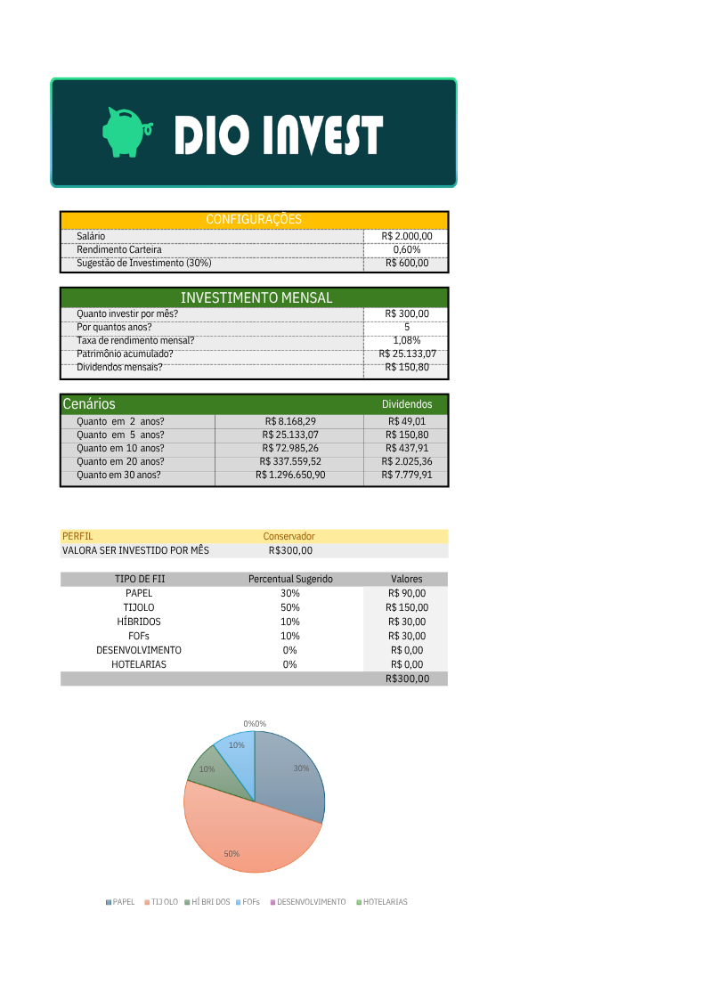
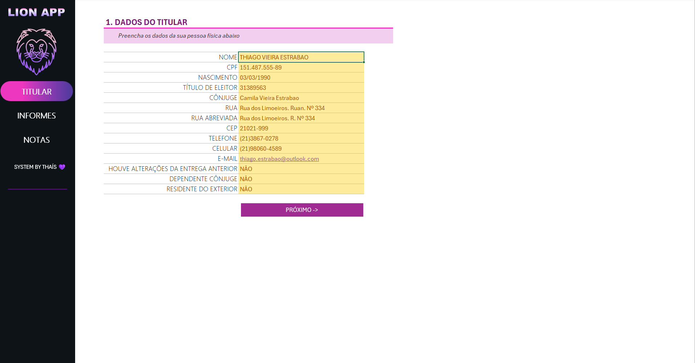
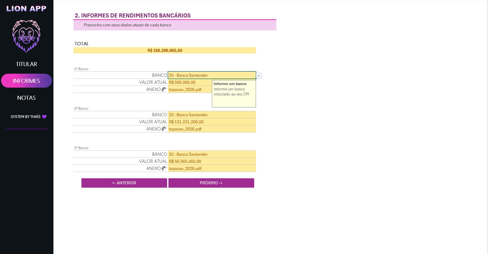
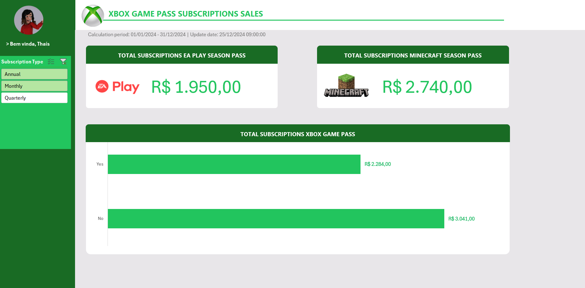

# (DIO - Excel & IA)

Repositório centralizado com ferramentas automatizadas para simulação financeira e organização fiscal desenvolvidas no Microsoft Excel.

---

### 1. 💰 Calculadora de Investimentos e Alocação de FIIs
* **O que faz:** Projeta o acúmulo de patrimônio a longo prazo (2 a 30 anos) e sugere a divisão de Fundos Imobiliários com base no perfil do usuário (Conservador, Moderado e Agressivo).
* **Fórmulas principais:** Projeções financeiras, buscas automáticas e validação de perfil.

| Tela do Simulador |
| :---: |
|  |

---

### 2. 🦁 Lion App - Organizador de Imposto de Renda
* **O que faz:** Centraliza e estrutura os dados necessários para a Declaração Anual do IRPF, organizando dados do titular, saldos bancários e controle de holerites.
* **Recursos principais:** Consolidação de receitas, gerenciamento de anexos e interface intuitiva.

| 👤 Dados do Titular | 🏦 Bancos e Saldos | 📄 Notas e Holerites |
| :---: | :---: | :---: |
|  |  |  |

---

### 3. 🃏 Database - Modelagem Relacional Pokémon
* **O que faz:** Implementa um banco de dados relacional em PostgreSQL para armazenamento e consulta de cartas Pokémon, utilizando tabelas normalizadas, scripts de carga de dados e views para simplificar consultas.
* **Recursos principais:** Modelagem relacional, chaves estrangeiras, scripts de migração e criação da view `vw_cards_complete` para consulta das cartas com informações descritivas em vez de IDs.

---

### 4. 🎮 Dashboard de Vendas Xbox 

* **O que faz:** Apresenta indicadores e métricas de vendas de assinaturas Xbox Game Pass em um dashboard interativo desenvolvido no Excel.
* **Recursos principais:** Tabelas dinâmicas, segmentação de dados, indicadores de faturamento e análise de vendas dos adicionais EA Play e Minecraft Season Pass. 

| Dashboard |
| :---: |
|  |

## 🛠️ Tecnologias
* Microsoft Excel (Dashboards, Tabelas Dinâmicas, Segmentação de Dados e Fórmulas)
* PostgreSQL (Modelagem Relacional, Views, Scripts SQL e Consultas)
* PowerShell (Automação de scripts de apoio)
